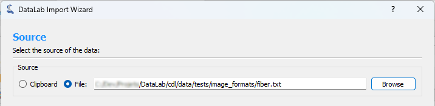
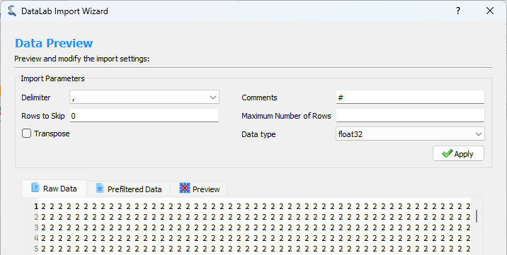
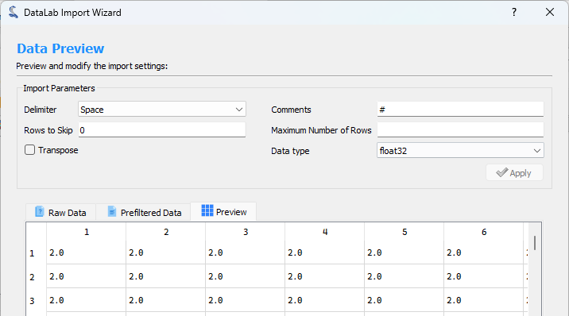
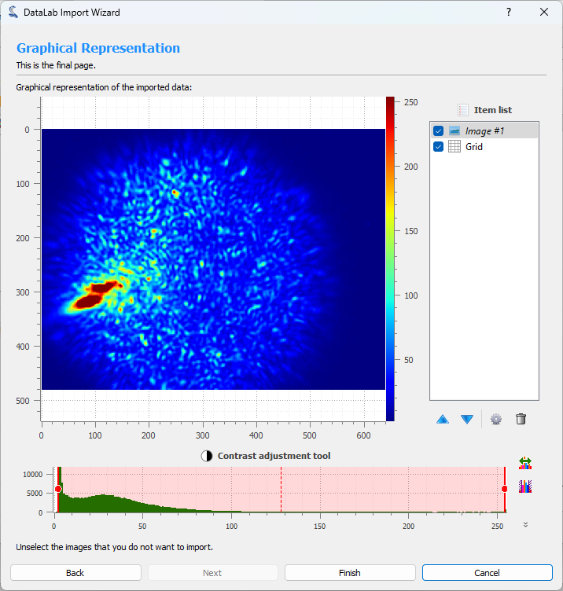

.. _ima-menu-file:

Open and save Images
====================

This section describes how to open and save images (and workspaces).

.. note::

    For creating new images from mathematical models, see :ref:`ima-menu-create`.

.. figure:: /images/shots/i_file.png

    Screenshot of the "File" menu.

When the "Image Panel" is selected, the menus and toolbars are updated to
provide image-related actions.

The "File" menu allows you to:

- Open, save and close images (see below).

- Save and restore the current workspace or browse HDF5 files (see :ref:`overview`).

- Export, inspect, replay and compare workspace capsules, i.e. a workspace with the
  provenance of its processing (see :ref:`capsules`).

- Edit DataLab preferences (see :ref:`settings`).

- Start or stop the Web API server, copy its connection information, and check
  its status (see :ref:`ref-to-webapi`).

- Quit DataLab.

.. _open_image:

Open image
^^^^^^^^^^

Create a new image from the following supported filetypes:

.. list-table::
    :header-rows: 1

    * - File type
      - Extensions
    * - PNG files
      - .png
    * - TIFF files
      - .tif, .tiff
    * - JPEG files
      - .jpg, .jpeg
    * - JPEG 2000 files
      - .jp2
    * - Bitmap images
      - .bmp
    * - NumPy arrays
      - .npy
    * - MAT-Files
      - .mat
    * - Text files
      - .txt, .csv, .asc
    * - HDF5 image files
      - .h5ima
    * - Andor SIF files
      - .sif
    * - Princeton Instruments SPE files
      - .spe
    * - Opticks GEL files
      - .gel
    * - Hamamatsu NDPI files
      - .ndpi
    * - PCO Camera REC files
      - .rec
    * - SPIRICON files
      - .scor-data
    * - Thales Pixium FXD files
      - .fxd
    * - Dürr NDT XYZ files
      - .xyz
    * - FT-Lab files
      - .ima
    * - Headerless RAW files
      - .raw

.. note::

    Thales Pixium FXD files, and the writing of Dürr NDT XYZ files, are supported
    by the built-in image formats plugin (``datalab_imageformats``).

When opening a headerless RAW file (``.raw``), DataLab displays a **RAW image import**
dialog to describe its binary layout: pixel data type, image width and height, offset to
the first image, number of images, gap between consecutive images, byte order, and the
**White is zero** option (which displays the imported image with an inverted gray
colormap without altering pixel values). Multi-image files create one image per frame.
When several RAW files are opened at once, DataLab asks whether to apply the same import
parameters to all of them or to set the parameters of each file individually.

.. note::

    DataLab also supports any image format that can be read by the `imageio` library,
    provided that the associated plugin(s) are installed (see `imageio documentation <https://imageio.readthedocs.io/en/stable/formats/index.html>`_)
    and that the output NumPy array data type and shape are supported by DataLab.

    To add a new file format, you may set the ``imageio_formats`` option of the
    Sigima library (``sigima.config.options.imageio_formats``), for example from a
    plugin. This option is formatted like the `IMAGEIO_FORMATS` object which
    represents the natively supported formats (formats added this way can only be
    opened, not saved):

    .. autodata:: sigima.config.IMAGEIO_FORMATS

Open from directory
^^^^^^^^^^^^^^^^^^^

Open multiple images from a specified directory.

Save image
^^^^^^^^^^

Save current image to the following supported filetypes (the other file types listed
in "Open image" can only be opened):

.. list-table::
    :header-rows: 1

    * - File type
      - Extensions
    * - PNG files
      - .png
    * - TIFF files
      - .tif, .tiff
    * - JPEG files
      - .jpg, .jpeg
    * - JPEG 2000 files
      - .jp2
    * - Bitmap images
      - .bmp
    * - NumPy arrays
      - .npy
    * - MAT-Files
      - .mat
    * - Text files
      - .txt, .csv, .asc
    * - HDF5 image files
      - .h5ima
    * - Dürr NDT XYZ files
      - .xyz

After choosing the destination file, DataLab opens an **Export image** dialog tailored to
the selected file format, with a live preview of the exported image (displayed in gray
levels as it will be read back from the file):

- **Data preparation**: normalization mode (none, min-max, percentile or manual bounds),
  out-of-range behavior (clip or rescale), non-finite value policy (error, clip or
  replace), gamma correction, inversion and target data type among those supported by the
  destination format. When a format only supports integer pixels (e.g. PNG, JPEG or BMP)
  and the source image uses another data type, min-max rescaling is selected by default.
- **Format-specific options**: compression, quality, predictor, tiling, resolution,
  photometric interpretation, text delimiter and precision, or MAT compression, depending
  on the chosen format.

Save images to directory
^^^^^^^^^^^^^^^^^^^^^^^^

Save all selected images to a specified directory, with configurable filename pattern
and image format.

.. figure:: /images/shots/i_save_to_directory.png

    Save images to directory dialog.

When you select "Save to directory..." from the File menu, a dialog appears where you can:

- **Directory**: Choose the target directory where images will be saved
- **Basename pattern**: Define a pattern for the filenames using Python format strings
  (the **Help** button describes the available placeholders)
- **Extension**: Select the output format (.png, .tiff, .h5ima, etc.)
- **Overwrite**: Choose whether to overwrite existing files
- **Preview**: See the list of files that will be created (each file name is
  preceded by the group and the title of the corresponding image)

The filename pattern supports the following placeholders:

- ``{title}``: Image title
- ``{index}``: 1-based index of the image in the selection (with zero-padding)
- ``{count}``: Total number of selected images
- ``{xlabel}``, ``{xunit}``, ``{ylabel}``, ``{yunit}``: Axis labels and units
- ``{metadata[key]}``: Access metadata values

You can also use format modifiers, for example ``{index:03d}`` will format the index
with 3 digits zero-padding (001, 002, 003, etc.).

Import text file
^^^^^^^^^^^^^^^^

DataLab can natively import many types of image files (e.g. TIFF, JPEG, PNG, etc.).
However some specific text file formats may not be supported. In this case, you can
use the `Import text file` feature, which allows you to import a text file and
convert it to an image.

This feature is accessible from the `File` menu, under the `Import text file` option.

It opens an import wizard that guides you through the process of importing the text
file.

Step 1: Select the source
-------------------------

The first step is to select the source of the text file. You can either select a file
from your computer or the clipboard if you have copied the text from another
application.

   Step 1: Select the source

Step 2: Preview and configure the import
-----------------------------------------

The second step consists of configuring the import and previewing the result. You can
configure the following options:

- **Delimiter**: The character used to separate the values in the text file.
- **Decimal**: The decimal separator (point or comma).
- **Comments**: The character used to indicate that the line is a comment and should be
  ignored.
- **Rows to Skip**: The number of rows to skip at the beginning of the file.
- **Max. nb of rows**: The maximum number of rows to import. If the file contains
  more rows, they will be ignored.
- **Header**: The row containing the column names, if any (none, inferred from the
  data, or first row).
- **Transpose**: If checked, the rows and columns will be transposed.
- **Data type**: The destination data type of the imported data.

When you are done configuring the import, click the `Apply` button to see the result.

   Step 2: Configure the import

   Step 2: Preview the result

Step 3: Show graphical representation
-------------------------------------

The third step shows a graphical representation of the imported data. You can use the
`Finish` button to import the data into DataLab workspace.

   Step 3: Show graphical representation