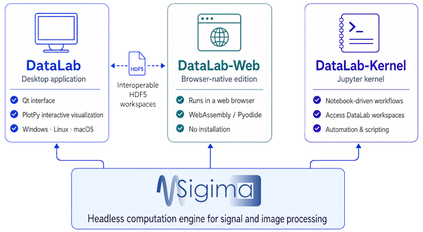

.. _ecosystem:

The DataLab Platform
====================

.. meta::
    :description: The DataLab Platform ecosystem - desktop application, browser-native DataLab-Web, DataLab-Kernel Jupyter kernel, the Sigima computation engine, the SigimaX application framework and the DataLab-Capsule provenance package
    :keywords: DataLab, DataLab Platform, DataLab-Web, browser, WebAssembly, Pyodide, DataLab-Kernel, Jupyter, Sigima, SigimaX, DataLab-Capsule, provenance, RO-Crate, desktop, ecosystem, editions

When DataLab started in 2023, it was a single product: a desktop application. Since then,
the same scientific core has grown into a small family of complementary tools — the
**DataLab Platform**. This page clarifies the terminology and helps you choose the edition
that best fits your needs.

    The DataLab Platform brings together the desktop application, DataLab-Web and
    DataLab-Kernel around the Sigima computation engine. DataLab-Web can open and save HDF5
    workspaces, but it does not preserve Desktop History, so round trips are not lossless.

.. seealso::

    The story behind this evolution — the extraction of the Sigima computation engine and
    the browser-native edition — is documented in the project reports and Architecture
    Decision Records published on the `DataLab wiki
    <https://github.com/DataLab-Platform/DataLab/wiki>`_.

.. _ecosystem_naming:

A note on terminology
---------------------

The word *DataLab* is used both for the whole family and for its historical member, the
desktop application. To avoid confusion, this documentation uses the following vocabulary:

.. list-table::
    :header-rows: 1
    :widths: 25 75

    * - Name
      - Meaning
    * - **DataLab Platform**
      - The umbrella term for the whole ecosystem (all the products listed below).
    * - **DataLab**
      - The reference **desktop application** (Qt-based). Unless stated otherwise, the rest
        of this documentation describes this product.
    * - **DataLab-Web**
      - The **browser-native** edition: a curated set of DataLab features running inside a
        web browser tab, with no installation. Try it at `datalab-platform.com/web
        <https://datalab-platform.com/web/>`_ --
        `project on GitHub <https://github.com/DataLab-Platform/web>`__.
    * - **DataLab-Kernel**
      - A **Jupyter kernel** exposing DataLab workspaces to notebooks — either live-synchronized
        with a running desktop session, or fully standalone (including in JupyterLite, in the
        browser). `Documentation <https://datalab-kernel.readthedocs.io/>`__.
    * - **Sigima**
      - The headless **computation engine** (signal and image processing) shared by all of
        the above. `Documentation <https://sigima.readthedocs.io/>`__.
    * - **SigimaX**
      - The **Qt application framework** on which the desktop application is built: generic
        main window, configuration system, dockable plot widgets, HDF5 workspace and
        browser, log viewer and scientific dialogs. Aimed at developers building their own
        Qt scientific application. `Documentation <https://sigimax.readthedocs.io/>`__.
    * - **DataLab-Capsule**
      - The **workspace provenance and capsule** package (``datalab-capsule``), used by
        both the desktop application and DataLab-Web: it records how results were
        obtained in the HDF5 workspace, and packages workspaces as open RO-Crate
        ``.dlcapsule`` archives to exchange, compare and verify them. Its library and
        command line do not require DataLab. `Project on GitHub
        <https://github.com/DataLab-Platform/DataLab-Capsule>`__.

.. note::

    This documentation site is, first and foremost, the documentation of the **desktop
    application**. Some core concepts and operations are shared across editions, but feature
    availability is not identical: DataLab-Web exposes a curated subset of Sigima processing
    operations. Edition-specific differences are called out explicitly.

Members of the platform
-----------------------

.. only:: html and not latex

    .. grid:: 1 1 2 2
        :gutter: 1 2 3 4

        .. grid-item-card:: |card-icon-device-desktop|  DataLab (desktop)

            The reference application, with a native Qt graphical user interface and the full
            PlotPyStack interactive visualization. Runs locally on Windows, Linux and macOS.

        .. grid-item-card:: |card-icon-browser|  DataLab-Web

            A curated set of DataLab features running in your browser via WebAssembly, with
            no DataLab server or installation required. Core processing stays in the browser.
            Try it at
            `datalab-platform.com/web <https://datalab-platform.com/web/>`_ or browse the
            `project on GitHub <https://github.com/DataLab-Platform/web>`__.

        .. grid-item-card:: |card-icon-terminal|  DataLab-Kernel

            A Jupyter kernel for notebook-driven workflows: live-synchronized with a running
            desktop session, or fully standalone — notebooks run unchanged with or without
            DataLab, including in JupyterLite. See the
            `DataLab-Kernel documentation <https://datalab-kernel.readthedocs.io/>`_.

        .. grid-item-card:: |card-icon-cpu|  Sigima

            The open-source computation engine that powers every edition. See the
            `Sigima documentation <https://sigima.readthedocs.io/>`_.

        .. grid-item-card:: |card-icon-stack|  SigimaX

            The Qt application framework extracted from DataLab: main window skeleton,
            configuration system, plot docks, HDF5 workspace and scientific dialogs — the
            foundation of the desktop application, reusable for your own Qt application.
            See the `SigimaX documentation <https://sigimax.readthedocs.io/>`_.

        .. grid-item-card:: |card-icon-file-zip|  DataLab-Capsule

            The provenance of the workspace and the open RO-Crate ``.dlcapsule``
            capsules, shared by the desktop application and DataLab-Web: exchange,
            compare and verify workspaces with the provenance of their processing (see
            :ref:`capsules`). Browse the
            `project on GitHub <https://github.com/DataLab-Platform/DataLab-Capsule>`__.

        .. grid-item-card:: |card-icon-package|  DataLab plugin catalog

            The plugins of the DataLab team and of the community, checked automatically
            and installable in one click from the desktop application, some of them also
            available in DataLab-Web. Browse the
            `DataLab plugin catalog <https://datalab-platform.com/plugins/>`_, or publish your
            own plugin (see :ref:`tutorial_plugin_catalog`).

.. only:: latex and not html

    - **DataLab (desktop)** — the reference application, with a native Qt graphical user
      interface and the full PlotPyStack interactive visualization.
    - **DataLab-Web** — the same platform, running entirely inside your browser via
      WebAssembly (`datalab-platform.com/web <https://datalab-platform.com/web/>`_).
    - **DataLab-Kernel** — a Jupyter kernel for notebook-driven workflows, live-synchronized
      with a running desktop session or fully standalone
      (`documentation <https://datalab-kernel.readthedocs.io/>`_).
    - **Sigima** — the open-source computation engine that powers every edition
      (`documentation <https://sigima.readthedocs.io/>`_).
    - **SigimaX** — the Qt application framework on which the desktop application is built,
      reusable to create other scientific Qt applications
      (`documentation <https://sigimax.readthedocs.io/>`_).
    - **DataLab-Capsule** — the provenance of the workspace and the open RO-Crate
      ``.dlcapsule`` capsules, shared by the desktop application and DataLab-Web
      (`project on GitHub <https://github.com/DataLab-Platform/DataLab-Capsule>`__).
    - **DataLab plugin catalog** — the plugins of the DataLab team and of the community,
      checked automatically and installable in one click from the desktop application
      (`datalab-platform.com/plugins <https://datalab-platform.com/plugins/>`_).

Which one should I use?
-----------------------

The desktop application and DataLab-Web are two access modes to the same platform and can
exchange HDF5 workspaces, but they are not fully interchangeable. DataLab-Web does not
preserve Desktop History when it opens and saves an HDF5 workspace, and its processing
catalog is a curated subset. A few rules of thumb:

- **Use the desktop application** when you work on your own machine and want the richest,
  fastest experience, the full set of interactive PlotPy tools, native file access, and the
  ability to handle very large datasets limited only by your system RAM.
- **Use DataLab-Web** when you cannot or do not want to install anything — for example on a
  shared or locked-down computer, on someone else's machine, or simply to give DataLab a
  quick try. Core processing runs locally in the browser without a DataLab server or account.
- **Use DataLab-Kernel** when your workflow is notebook-centric and you want DataLab's
  processing catalog available from a Jupyter notebook — for example to write reproducible
  analysis reports that can be replayed with or without DataLab. You can `try it online
  <https://notebook.link/github/DataLab-Platform/DataLab-Kernel/tree/main/notebooks/?path=/notebooks/datalab_kernel_quickstart.ipynb>`_
  in a live JupyterLite environment, without installing anything.

A common pattern is to use the desktop application on your personal workstation and
DataLab-Web elsewhere, exchanging workspace data through HDF5 files. DataLab-Web does not
preserve Desktop History, so round trips can lose that information.

DataLab vs DataLab-Web
----------------------

DataLab-Web shares the **computation engine** (Sigima) with the desktop application and
exposes a curated subset of its processing catalog. The very same Sigima code — not a port —
runs on CPython (desktop) and on Pyodide (browser). For operations available in both editions,
compatible versions of Sigima give identical results, or results within the tolerance
declared by the operation contract. The available operations and runtime environment differ
between editions.

.. list-table::
    :header-rows: 1
    :widths: 22 39 39

    * - Topic
      - DataLab (desktop)
      - DataLab-Web
    * - Installation
      - Installed locally (Windows, Linux, macOS)
      - None — runs in the browser
    * - Python runtime
      - System CPython
      - Pyodide (CPython compiled to WebAssembly)
    * - Graphical interface
      - Qt + PlotPy
      - React + Plotly.js
    * - Plotting
      - PlotPy (Qt), full interactive tools
      - Plotly.js (interactive tools partially reimplemented)
    * - File access
      - Native file system I/O
      - Browser file picker, drag-and-drop
    * - Persistence
      - HDF5 and ``.dlcapsule`` files on disk
      - HDF5 and ``.dlcapsule`` download / upload; Desktop History is not preserved when
        DataLab-Web opens and saves an HDF5 workspace
    * - Memory
      - Limited by system RAM (64-bit)
      - ~2 GB WebAssembly heap by default; an optional on-disk storage mode lifts this
        limit entirely, bounding the working set by available disk space instead of RAM
    * - Responsiveness
      - Computations run in separate worker processes; the interface stays responsive and
        processings can be cancelled
      - The Python runtime lives in a Web Worker, off the interface thread; the interface
        stays responsive and batch processings can be cancelled at object boundaries
    * - Languages
      - English and French
      - English and French (browser language detected automatically)
    * - Remote control
      - XML-RPC and FastAPI Web API
      - In-browser proxy and optional ``postMessage`` SDK

Both editions use the Sigima computation engine and can exchange HDF5 workspace files, but
the features and information they preserve are not identical. DataLab-Web provides a
curated subset of Sigima operations and does not preserve Desktop History when it opens and
saves an HDF5 workspace. Check the edition-specific documentation before moving a workspace
between them.

.. note::

    Plugins are largely portable between the desktop application and DataLab-Web, with a few
    constraints related to the browser runtime. See :ref:`plugins_web` for details.

.. include:: /_card_icons.txt
