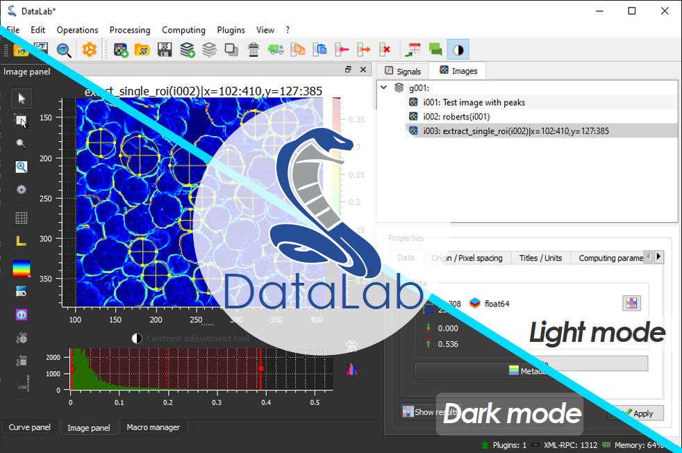

.. _key_features:

Key features
============

.. meta::
    :description: Key features of DataLab, the open-source data visualization and processing platform for scientists and engineers
    :keywords: DataLab, key features, signal processing, image processing, data visualization

This page presents briefly DataLab key features.

    DataLab supports dark and light mode. The color mode may be chosen in the
    "General" tab of the :ref:`settings`: by default ("auto" mode), it follows your
    platform settings (this is handled by the
    `guidata <https://pypi.python.org/pypi/guidata>`_ package, and may be overridden
    by setting the `QT_COLOR_MODE` environment variable to `dark` or `light`).

Data visualization
^^^^^^^^^^^^^^^^^^

====== ====== ====================================
Signal Image  Feature
====== ====== ====================================
✓      ✓      Screenshots (save, copy)
✓      Z-axis Lin/log scales
✓      ✓      Data table editing
✓      ✓      Statistics on user-defined ROI
✓      ✓      Markers
..     ✓      Aspect ratio (1:1, custom)
..     ✓      50+ available colormaps (customizable)
..     ✓      Intensity profiles (line, average, radial)
✓      ✓      Annotations
✓      ✓      Persistence of settings in workspace
..     ✓      Distribute images on a grid
✓      ✓      Single or superimposed views
====== ====== ====================================

Data processing
^^^^^^^^^^^^^^^

====== ====== ===================================================
Signal Image  Feature
====== ====== ===================================================
✓      ✓      Process isolation for running computations
✓      ✓      Remote control from Jupyter, Spyder or any IDE
✓      ✓      Remote control from a third-party application
✓      ✓      Sum, average, difference, product...
✓      ✓      Operations with a constant
✓      ✓      Logarithm, exponential...
✓      ..     Square root, power
✓      ✓      Average, standard deviation
✓      ..     Derivative, integral
✓      ✓      ROI extraction, Swap X/Y axes
✓      ..     Semi-automatic multi-peak detection
✓      ✓      Convolution, deconvolution
..     ✓      Flat-field correction
..     ✓      Flip, rotation, scaling...
..     ✓      Intensity profiles (line, average, radial)
..     ✓      Horizontal and vertical projections
..     ✓      Pixel binning
✓      ..     Linear calibration
..     ✓      Polynomial calibration
✓      ✓      Normalization, Clipping, Offset correction
✓      ..     Reverse X-axis
✓      ..     Replace X by other signal's Y (calibration)
✓      ..     X-Y mode
..     ✓      Thresholding (manual, Otsu...)
✓      ✓      Gaussian filter, Wiener filter
✓      ✓      Moving average, moving median
✓      ✓      FFT, inverse FFT, Power/Phase/Magnitude spectrum, Power Spectral Density
✓      ..     Interpolation
✓      ✓      Resampling
✓      ..     Detrending
✓      ..     Interactive fit: Gauss, Lorentz, Voigt, polynomial, CDF...
✓      ..     Interactive multigaussian fit
✓      ..     Frequency filters (low-pass, high-pass, band-pass, band-stop)
✓      ..     Windowing (Hann, Hamming...)
✓      ..     Stability analysis (Allan variance, Hadamard variance...)
..     ✓      Butterworth filter
..     ✓      Exposure correction (gamma, log...)
..     ✓      Restoration (Total Variation, Bilateral...)
..     ✓      Morphology (erosion, dilation...)
..     ✓      Edge detection (Roberts, Sobel...)
✓      ✓      Analysis on custom ROI
✓      ..     FWHM, FW @ 1/e²
✓      ..     Pulse features extraction
✓      ..     Dynamic parameters (ENOB, SNR...), Sampling period/Rate
..     ✓      Centroid (robust method w/r noise)
..     ✓      Minimum enclosing circle center
..     ✓      2D peak detection
..     ✓      Contour detection
..     ✓      Circle Hough transform
..     ✓      Blob detection (OpenCV, Laplacian of Gaussian...)
====== ====== ===================================================

Workspace and traceability
^^^^^^^^^^^^^^^^^^^^^^^^^^

- HDF5 workspaces, and an HDF5 browser to import data sets from any HDF5 or NeXus
  file (see :ref:`h5browser`)
- History panel to record, replay (silently or step by step) and duplicate processing
  chains (see :ref:`historypanel`)
- Provenance of results: how each result was obtained, checked against the data and
  verified by recomputation (see :ref:`provenance`)
- Workspace capsules (``.dlcapsule``) to exchange a workspace with the provenance of
  its processing (see :ref:`capsules`)
- Welcome page, Applications panel and command palette (see :ref:`overview`)
- Optional AI assistant (see :ref:`ai_assistant`)

Extensibility
^^^^^^^^^^^^^

- Plugins adding processing features, file formats or complete applications, reloaded
  without restarting DataLab (see :ref:`about_plugins`)
- `DataLab plugin catalog <https://datalab-platform.com/plugins/>`_: official and community
  plugins, installed in one click from DataLab
- Plugin generator: a working plugin in a single Python file, ready to publish in the
  catalog (see :ref:`tutorial_plugin_catalog`)
- Macro-commands, remote control and Web API to automate DataLab from Python, Jupyter
  notebooks or any application
