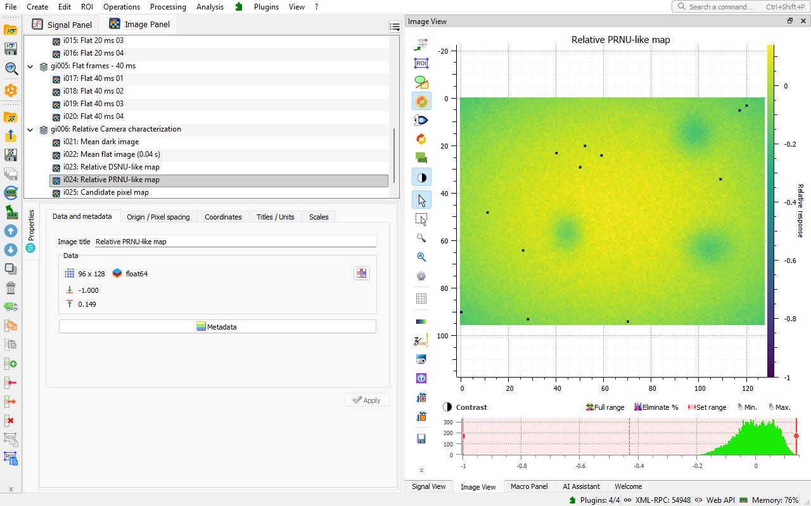

.. _use_case_camera:

DataLab for scientific camera characterization
==============================================

.. meta::
    :description: Characterize scientific cameras and detectors from dark and flat frames: response, temporal noise, DSNU and PRNU maps, photon transfer curve, conversion gain, read noise, dark current and hot pixels -- with DataLab, the open-source signal and image analysis platform, and its Camera & Detector Characterization plugin.
    :keywords: camera characterization software, detector characterization, photon transfer curve, PTC, conversion gain, read noise, dark current, hot pixels, DSNU, PRNU, flat field, dark frame, scientific camera, CMOS, CCD, open-source, DataLab

The problem
-----------

Before trusting the images of a scientific camera or detector, you need to know
how it behaves in your own conditions: its response to light, its temporal
noise, the non-uniformity of its pixels, its conversion gain and read noise,
its dark current and its defective pixels. Datasheets give typical values, not
those of your unit at your settings; ad hoc scripts take time to write and
validate, and their results are hard to compare from one camera, one setting or
one campaign to the next.

What DataLab does
-----------------

The `Camera & Detector Characterization
<https://github.com/DataLab-Platform/datalab-camera-characterization>`_ plugin
adds complete characterization methods to DataLab, run on the dark and flat
frames of your workspace:

- **relative characterization** in digital numbers (DN): response curve,
  temporal noise, DSNU-like and PRNU-like maps, row and column profiles,
  candidate defective pixels,
- **photon transfer curve**: conversion gain (e⁻/DN), read noise, saturation
  capacity and dynamic range,
- **dark current and hot pixels**, from a dark ramp,
- results added to the workspace as signals, images and metrics tables, next to
  the frames they come from, ready for the processing and analysis features of
  DataLab and saved with them in the workspace,
- a **scientific camera simulator**, with a live view, which acquires dark and
  flat frames ready for the methods,
- the methods and their examples are presented in the :ref:`applications_panel`,
  which tells whether the selected frames can be analyzed, and why not.

    Relative PRNU-like map computed from the quickstart campaign of the Camera &
    Detector Characterization plugin in DataLab.

Status
------

The plugin is an official plugin of the `DataLab plugin catalog
<https://datalab-platform.com/plugins/>`_, for DataLab Desktop and DataLab-Web,
at the Alpha stage: its methods are validated on synthetic data with known
truth, and do not claim compliance with the EMVA 1288 standard.

Try it
------

- :octicon:`rocket;1em;sd-text-info` **No install:** open
  `DataLab-Web with the quickstart campaign loaded and the camera
  characterization method selected
  <https://datalab-platform.com/web/?plugin=org.datalab.camera-characterization&pluginVersion=0.2.1&recipe=org.datalab.camera-characterization:relative-dn-characterization&recipeVersion=1.1.0&example=quickstart>`_
  in your browser -- your data never leaves your machine.
- :octicon:`package;1em;sd-text-info` **In DataLab Desktop:** install the plugin
  from the **Catalog** tab of **Plugins > Configure plugins...** (see
  :ref:`plugin_catalog`), then click its tile on the :ref:`welcome_page`.
- :octicon:`book;1em;sd-text-info` **Plugin documentation:** `getting started
  and methods
  <https://github.com/DataLab-Platform/datalab-camera-characterization/blob/develop/doc/README.md>`_.
- :octicon:`download;1em;sd-text-info` Or :ref:`install the desktop application <installation>`.
