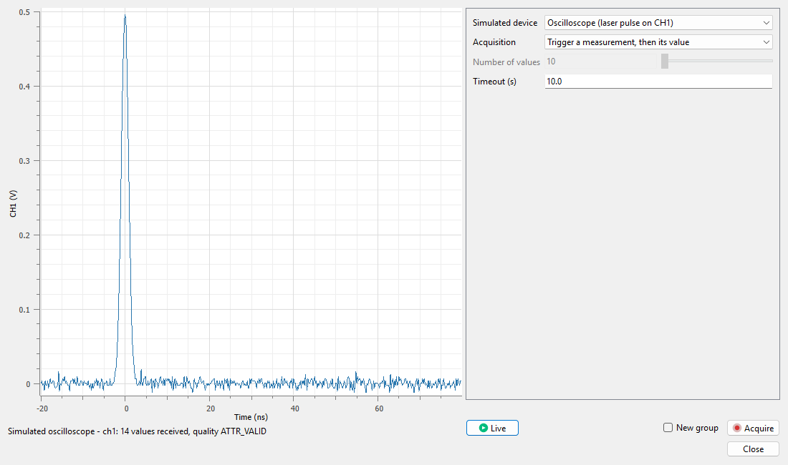

.. _use_case_instruments:

DataLab for instrument control and data acquisition
===================================================

.. meta::
    :description: Connect DataLab to your instruments with an instrument plugin: live view next to the instrument settings, acquisition of signals and images into the workspace with their origin, ready for processing -- illustrated by the TANGO Instruments example plugin, with simulated devices to try it without hardware.
    :keywords: instrument control software, data acquisition software, laboratory instrument, live view, oscilloscope, camera, TANGO, PyTango, device server, control system, instrument plugin, acquisition metadata, open-source, DataLab

The problem
-----------

On a test bench or a facility, data usually go from the instrument to its
vendor software, then to files, then to the analysis tool: there is no live link
between what the instrument measures and what you analyze, and the acquisition
context -- which device, which setting, when -- is easily lost along the way.
Writing a dedicated acquisition application for each instrument, with its own
display and analysis, is expensive.

What DataLab does
-----------------

A DataLab plugin may provide **instruments**: the plugin describes the
instrument settings and how to read or control the device, and DataLab provides
the user interface (see :ref:`plugins_instruments`):

- a window with a **live view** of the instrument data (signals or image) next
  to its **settings**, refreshed when the settings change or continuously in
  **Live** mode,
- **Acquire** adds the acquired signals or images to the workspace, in a new
  group or in the current one, selected and ready for the processing, analysis
  and application methods of DataLab,
- the instrument is called outside the user interface thread: a slow or
  unreachable device does not freeze DataLab, and it is released when the
  window closes,
- the plugin may record the origin of each acquired object (device, settings,
  time) in its metadata, which is saved with the workspace.

The `TANGO Instruments <https://github.com/DataLab-Platform/datalab-tango>`_
example plugin shows this approach with the devices of the `TANGO
<https://www.tango-controls.org/>`_ control system, used by many large research
facilities:

- a device attribute is shown live, a spectrum as a signal, an image as an
  image, with the units and axis calibrations given by a JSON **device
  profile**, which holds the site-specific values (device name, calibrations,
  commands),
- **Acquire** copies the last received value, runs the **trigger command** of
  the profile and takes the value it measured, or takes a series of the next
  received values,
- each acquired object records its origin (device, attribute, times, quality,
  profile and trigger): a saved workspace reopens without the device nor the
  plugin,
- a simulated oscilloscope and a simulated camera let you try it without
  hardware: the **Simulated TANGO devices...** tool serves them with PyTango on
  your computer while its window is open, without any command line, and stops
  them when the window closes.

The simulators of the :ref:`camera <use_case_camera>` and :ref:`pulse
<use_case_pulse>` characterization plugins are instruments of the same kind.
Acquisition software may also send its data to DataLab, with the
:ref:`remote control <ref-to-remote-control>` (XML-RPC) or the
:ref:`Web API <ref-to-webapi>` (HTTP/JSON).

    Live view of the simulated oscilloscope in the window of the **Simulated
    TANGO devices...** tool of the TANGO Instruments plugin in DataLab.

Status
------

TANGO Instruments is an official example plugin of the `DataLab plugin catalog
<https://datalab-platform.com/plugins/>`_: it is a demonstration, not a finished
or supported feature, and has been validated with simulated devices only. It
requires PyTango in the Python environment of DataLab: the standalone
application and DataLab-Web, which cannot reach TANGO devices, are not
supported.

Try it
------

- :octicon:`package;1em;sd-text-info` **In DataLab:** install PyTango in the
  Python environment of DataLab (e.g. ``pip install "pytango>=9.5.1"``), then
  the plugin from the **Catalog** tab of **Plugins > Configure plugins...**
  (see :ref:`plugin_catalog`).
- :octicon:`beaker;1em;sd-text-info` **Without hardware:** open
  **Simulated TANGO devices...** from the :ref:`applications_panel` or from the
  plugin's submenu of the **Plugins** menu, choose the simulated oscilloscope or
  camera, then click **Acquire**. To serve the same devices to another TANGO
  client, run ``python -m datalab_tango.simulation profiles`` in this Python
  environment.
- :octicon:`book;1em;sd-text-info` **Plugin documentation:** `device profiles,
  acquisition modes and simulated devices
  <https://github.com/DataLab-Platform/datalab-tango/blob/v0.1.1/README.md>`_.
- :octicon:`tools;1em;sd-text-info` **Your own instruments:** see
  :ref:`plugins_instruments` and :ref:`tutorial_plugin_catalog`.
