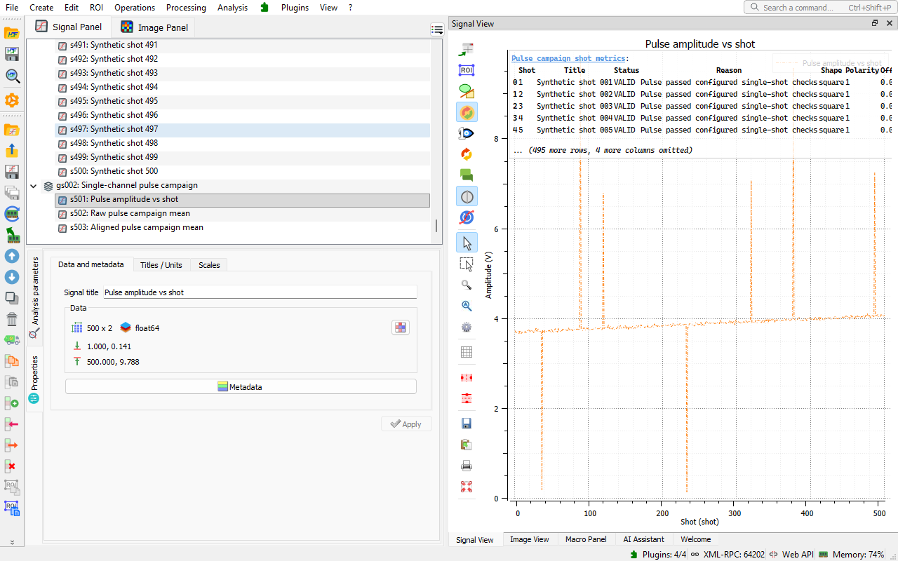

.. _use_case_pulse:

DataLab for transient and pulsed signals
========================================

.. meta::
    :description: Analyze transient and pulsed signals from oscilloscopes and digitizers: pulse features, rise time, shot-to-shot stability, timing jitter, Allan deviation, step response, delay between channels and pulse-height spectra -- with DataLab, the open-source signal and image analysis platform, and its Pulse & Transient Characterization plugin.
    :keywords: pulse analysis software, transient analysis, oscilloscope data analysis, digitizer, rise time, FWHM, timing jitter, shot-to-shot stability, Allan deviation, step response, overshoot, settling time, channel delay, pulse-height spectrum, pulsed laser, open-source, DataLab

The problem
-----------

Pulsed lasers, pulse generators, amplifiers, detectors and accelerators are
characterized from transient signals recorded by oscilloscopes and digitizers,
often over hundreds of shots: which shots are valid, what the representative
pulse looks like, how much the timing jitters and the amplitude drifts, how fast
a system responds to a step, what the delay between two channels is. Oscilloscope
measurements describe one shot at a time, and campaign scripts must handle
baselines, polarities, invalid shots and alignment before giving any number.

What DataLab does
-----------------

DataLab analyzes transient signals out of the box:

- **Analysis > Extract pulse features...** gives the amplitude, rise and fall
  times, FWHM and timing of step and square pulses (see
  :doc:`../features/signal/menu_analysis`),
- **Processing > Stability analysis** gives the Allan, Hadamard and total
  variances and the Allan and time deviations of a time series (see
  :doc:`../features/signal/menu_processing`).

The `Pulse & Transient Characterization
<https://github.com/DataLab-Platform/datalab-pulse-characterization>`_ plugin
adds complete methods for series of shots:

- **pulse campaign**: per-shot features and quality flags, raw and aligned mean
  pulses,
- **shot-to-shot stability**: timing jitter, drifts, amplitude and energy
  stability, Allan deviation, regime changes,
- **step response**: rise time, overshoot, settling time, ringing and bandwidth,
- **delay between two channels**, with relative and common-mode jitter,
- **pulse-height spectrum**: energy calibration and resolution of a detector,
- an **oscilloscope simulator**, with a live view, which acquires laser pulses,
  amplifier steps or delayed pulse pairs ready for the methods.

Results are added to the workspace as signals and metrics tables, and the
methods and their examples are presented in the :ref:`applications_panel`.

    Amplitude versus shot, with its per-shot metrics table, computed from the
    500-shot demonstration campaign of the Pulse & Transient Characterization
    plugin in DataLab.

Status
------

The plugin is an official plugin of the `DataLab plugin catalog
<https://datalab-platform.com/plugins/>`_, for DataLab Desktop and DataLab-Web,
at the Alpha stage: its methods are validated on synthetic data with known
truth, and do not claim compliance with a standard.

Try it
------

- :octicon:`rocket;1em;sd-text-info` **No install:** open
  `DataLab-Web with a 500-shot campaign and the pulse campaign method selected
  <https://datalab-platform.com/web/?plugin=org.datalab.pulse-characterization&pluginVersion=0.2.1&recipe=org.datalab.pulse-characterization:single-channel-campaign&recipeVersion=1.1.0&example=demo>`_
  in your browser -- your data never leaves your machine.
- :octicon:`package;1em;sd-text-info` **In DataLab Desktop:** install the plugin
  from the **Catalog** tab of **Plugins > Configure plugins...** (see
  :ref:`plugin_catalog`), then click its tile on the :ref:`welcome_page`.
- :octicon:`book;1em;sd-text-info` **Plugin documentation:** `getting started
  and methods
  <https://github.com/DataLab-Platform/datalab-pulse-characterization/blob/develop/doc/README.md>`_.
- :octicon:`download;1em;sd-text-info` Or :ref:`install the desktop application <installation>`.
